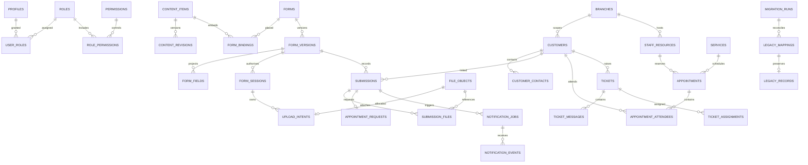

# Proposed Supabase PostgreSQL schema

Status: design only; no SQL files, tables, migrations, credentials or Supabase resources were created. This is a new PostgreSQL schema, not a MySQL import and not a change to the original WordPress schema.

## Conventions and authority

- Application IDs: `uuid` PK with database-generated defaults. Legacy numeric/string IDs remain in `legacy_mappings`; they are not reused as UUIDs.
- Times: `timestamptz` for instants; `date` for birth/business dates; `time` plus IANA zone for recurring availability. Migration records retain original timezone/text and conversion decision.
- Money: `numeric(14,2)` and a three-letter currency code; no floating-point financial arithmetic. Durations are integer seconds/minutes with positive bounds.
- All mutable business tables have `created_at timestamptz`, `updated_at timestamptz`; actor columns reference `profiles.id` where appropriate. Tables below omit repeated timestamps unless their meaning differs.
- FKs default `ON DELETE RESTRICT`. Pure association rows can cascade only when safe; actor references can become NULL when offboarding. Erasure/retention uses an audited workflow rather than cascading customer deletion through submissions.
- Controlled status/type values use reviewed CHECK constraints or lookup tables. JSONB must be an object/array of the expected kind and pass server schema validation; arbitrary JSON is not a permission model.
- Sensitive answers and source archives use `bytea` ciphertext, authenticated encryption metadata and key references. Keys live outside the database. Contact fields remain access-restricted; high-risk identifiers belong in encrypted details.
- Each encrypted `bytea` value is a versioned authenticated envelope containing its nonce/tag and algorithm metadata, including where a separate metadata column is not listed. Do not reuse nonces or omit authentication checks.
- RBAC records and policy helper functions are protected. No user can edit their own roles through profile metadata.

## Table definitions

`?` means nullable. `FK table` means a reference to that table's PK. All table/column names are proposed.

### Identity and configuration

| Table | Columns and relationships | Constraints / indexes |
|---|---|---|
| `profiles` | `id uuid PK FK auth.users`, `display_name text`, `status text`, `last_admin_login_at timestamptz?` | Auth account not a business customer; status active/suspended; ordinary user can update only allowed self-profile columns |
| `roles` | `id text PK`, `name text`, `is_sensitive_admin boolean` | Seed reviewed roles; only owner can grant privileged roles |
| `permissions` | `code text PK`, `description text` | Stable codes, e.g. forms.publish, submissions.read/export, bookings.manage |
| `role_permissions` | `role_id text FK roles`, `permission_code text FK permissions` | Composite PK `(role_id,permission_code)` |
| `user_roles` | `user_id uuid FK profiles`, `role_id text FK roles`, `granted_by uuid FK profiles`, `granted_at timestamptz` | Composite PK `(user_id,role_id)`; grant/revoke audit; no self-service insert/update |
| `branches` | `id uuid PK`, `code text`, `name text`, `timezone text`, `address jsonb`, `public_contacts jsonb`, `active boolean` | Unique code; timezone allowlisted to valid IANA names; public contact projection excludes recipients/private settings |
| `user_branch_access` | `user_id uuid FK profiles`, `branch_id uuid FK branches` | Composite PK; owner/global admin permission can override branch scope explicitly |
| `application_settings` | `key text PK`, `value jsonb`, `visibility text`, `updated_by uuid FK profiles` | Allowlisted settings, no real service credentials; optimistic revision/version integer |

### Content and forms

| Table | Columns and relationships | Constraints / indexes |
|---|---|---|
| `content_items` | `id uuid PK`, `kind text`, `path text`, `title text`, `status text`, `published_revision_id uuid?`, `published_at timestamptz?`, `parent_id uuid? FK content_items` | Unique normalised path; reserved paths rejected; status draft/published/archived; index `(status,kind,published_at)` |
| `content_revisions` | `id uuid PK`, `content_id uuid FK content_items`, `revision integer`, `blocks jsonb`, `seo jsonb`, `created_by uuid FK profiles` | Unique `(content_id,revision)`; immutable; published pointer must reference a revision of the same content item |
| `navigation_items` | `id uuid PK`, `menu text`, `parent_id uuid? FK navigation_items`, `content_id uuid? FK content_items`, `external_url text?`, `label text`, `position integer`, `enabled boolean` | Exactly one content/approved external target, or an explicit group item; no parent cycles; index `(menu,parent_id,position)` |
| `redirects` | `id uuid PK`, `source_path text`, `target text`, `http_status smallint`, `enabled boolean` | Unique source; 301/302/307/308 allowlist; destination validated, loop/chain check |
| `forms` | `id uuid PK`, `slug text`, `title text`, `status text`, `current_version_id uuid?`, `owner_branch_id uuid? FK branches` | Unique slug; current version must belong to form; status draft/published/archived |
| `form_versions` | `id uuid PK`, `form_id uuid FK forms`, `version integer`, `schema_json jsonb`, `schema_hash text`, `state text`, `is_partial_legacy boolean`, `created_by uuid?`, `published_by uuid?`, `published_at timestamptz?` | Unique `(form_id,version)` and `(id,form_id)`; immutable after publish; frozen rules/consent copy; JSON size/node limits |
| `form_fields` | `id uuid PK`, `form_version_id uuid FK form_versions`, `field_key text`, `field_type text`, `label text`, `position integer`, `classification text`, `config jsonb` | Unique `(form_version_id,field_key)`; derived projection of version schema, rebuilt in same publish transaction; not a competing editable definition |
| `form_bindings` | `id uuid PK`, `form_id uuid FK forms`, `content_id uuid? FK content_items`, `path text`, `placement text`, `active boolean` | Index active path; unique `(path,placement)`; preserve multiple source placements deliberately |
| `notification_rules` | `id uuid PK`, `form_id uuid? FK forms`, `branch_id uuid? FK branches`, `event_type text`, `route_key text`, `recipient_config_ciphertext bytea`, `template_version integer`, `enabled boolean` | No public SELECT; deterministic routing priority; routing configuration not in public form schema |

`form_versions.schema_json` is the canonical immutable definition. `form_fields` supports search/report metadata and stable field identification; changing its projection directly is forbidden. New versions may reuse field keys but not change their semantic meaning silently. Source definitions whose exact historical version is unavailable get a clearly marked partial legacy version and raw archive, not a fabricated exact schema.

### Intake and customer records

| Table | Columns and relationships | Constraints / indexes |
|---|---|---|
| `form_sessions` | `id uuid PK`, `form_version_id uuid FK form_versions`, `token_hash text`, `csrf_binding_hash text`, `expires_at timestamptz`, `revoked_at timestamptz?`, `state text` | Unique token hash; index expires_at; no anonymous table access; token verification through server |
| `submissions` | `id uuid PK`, `reference text`, `form_id uuid FK forms`, `form_version_id uuid`, `form_session_id uuid? FK form_sessions`, `customer_id uuid? FK customers`, `branch_id uuid? FK branches`, `status text`, `answers_ciphertext bytea`, `encryption_key_ref text`, `encryption_meta jsonb`, `safe_summary jsonb`, `received_at timestamptz`, `reviewed_by uuid?`, `legacy_status text?`, `retention_until date?`, `legal_hold boolean` | Composite FK `(form_version_id,form_id)` to versions; unique reference; index `(form_id,received_at DESC)`, `(branch_id,status,received_at)` and customer; summary allowlist contains no sensitive identifiers |
| `submission_reviews` | `id uuid PK`, `submission_id uuid FK submissions`, `author_id uuid FK profiles`, `status_from text?`, `status_to text?`, `note_ciphertext bytea?`, `key_ref text?` | Append-only review history; index `(submission_id,created_at)` |
| `customers` | `id uuid PK`, `kind text`, `display_name text`, `branch_id uuid? FK branches`, `status text`, `auth_user_id uuid? FK auth.users`, `merged_into_id uuid? FK customers` | Person/company/trust kinds; no automatic unique-email merge; index branch/status/name; merge cycles forbidden |
| `customer_contacts` | `id uuid PK`, `customer_id uuid FK customers`, `kind text`, `value text`, `normalised_value text`, `verified_at timestamptz?`, `is_primary boolean` | Non-unique lookup index `(kind,normalised_value)`; per-customer primary constraint; emails/phones protected by RLS |
| `customer_relationships` | `id uuid PK`, `from_customer_id uuid FK customers`, `to_customer_id uuid FK customers`, `relationship_type text`, `valid_from date?`, `valid_to date?` | No self-link; unique relationship keys; parent/beneficiary/trustee/household roles reviewed from source |
| `customer_private_details` | `customer_id uuid PK FK customers`, `ciphertext bytea`, `key_ref text`, `encryption_meta jsonb`, `retention_until date?`, `legal_hold boolean` | Contains identity/tax details only when required; explicit permission and MFA for decryption |
| `consent_events` | `id uuid PK`, `customer_id uuid? FK customers`, `submission_id uuid? FK submissions`, `form_version_id uuid? FK form_versions`, `purpose text`, `action text`, `wording_hash text`, `occurred_at timestamptz`, `evidence_ciphertext bytea?` | Append-only; grant/withdraw separate; only necessary network evidence retained for approved period |
| `idempotency_requests` | `id uuid PK`, `scope text`, `subject_hash text`, `request_key text`, `payload_hash text`, `result_type text?`, `result_id uuid?`, `state text`, `expires_at timestamptz` | Unique `(scope,subject_hash,request_key)`; reusing key with different payload => conflict; scope allowlists result type; atomic completion in business transaction |
| `rate_limit_buckets` | `key_hash text`, `window_start timestamptz`, `count integer`, `expires_at timestamptz` | Composite PK `(key_hash,window_start)`; atomic increment; no raw IP; worker cleanup |

`answers_ciphertext` holds the full typed answer document including repeats. Do not create unrestricted plaintext answer projections for reporting. Authorised server services decrypt for viewing and controlled export; safe aggregates use allowlisted attributes. Any future field-level search index needs a separate privacy review.

### Files and messaging

| Table | Columns and relationships | Constraints / indexes |
|---|---|---|
| `file_objects` | `id uuid PK`, `bucket text`, `object_key text`, `original_name text`, `declared_mime text`, `verified_mime text?`, `bytes bigint?`, `sha256 text?`, `scan_status text`, `scan_engine text?`, `scanned_at timestamptz?`, `retention_until date?`, `legal_hold boolean` | Unique `(bucket,object_key)`; nonnegative size; pending/clean/infected/rejected/missing; index scan/retention |
| `upload_intents` | `id uuid PK`, `session_id uuid FK form_sessions`, `file_id uuid FK file_objects`, `field_key text`, `repeat_path text[]`, `max_bytes bigint`, `expires_at timestamptz`, `state text` | One intent/file; maximum files/bytes reserved atomically per session; no applicant-chosen object path |
| `submission_files` | `submission_id uuid FK submissions`, `file_id uuid FK file_objects`, `field_key text`, `repeat_path text[]`, `purpose text` | Composite PK `(submission_id,file_id)`; unique file ownership for intake; version/field/intent/session consistency checked transactionally |
| `notification_jobs` | `id uuid PK`, `event_key text`, `submission_id uuid? FK submissions`, `appointment_id uuid? FK appointments`, `ticket_id uuid? FK tickets`, `channel text`, `recipient_ciphertext bytea`, `payload_ciphertext bytea`, `key_ref text`, `state text`, `attempt_count integer`, `next_attempt_at timestamptz`, `lease_owner text?`, `lease_until timestamptz?`, `provider_message_id text?`, `last_error_code text?` | Unique event key includes recipient/template event; index `(state,next_attempt_at)`; no answers in mail payload; captured jobs never automatically released |
| `notification_events` | `id uuid PK`, `job_id uuid FK notification_jobs`, `provider text`, `provider_event_id text`, `status text`, `occurred_at timestamptz`, `safe_metadata jsonb` | Unique `(provider,provider_event_id)`; immutable event stream; accepted/delivered/bounced distinct |
| `export_jobs` | `id uuid PK`, `requested_by uuid FK profiles`, `scope jsonb`, `reason text`, `state text`, `file_id uuid? FK file_objects`, `expires_at timestamptz`, `lease_until timestamptz?` | Permission rechecked when generating and downloading; no public objects; index state/expiry |

### Scheduling and support

| Table | Columns and relationships | Constraints / indexes |
|---|---|---|
| `services` | `id uuid PK`, `name text`, `duration_seconds integer`, `buffer_before_seconds integer`, `buffer_after_seconds integer`, `price numeric(14,2)`, `currency char(3)`, `active boolean` | Positive duration; nonnegative price/buffers; source capacity is 1 in this snapshot |
| `staff_resources` | `id uuid PK`, `profile_id uuid? FK profiles`, `branch_id uuid FK branches`, `display_name text`, `timezone text`, `active boolean` | Staff record may exist without login; valid IANA zone; index branch/active |
| `staff_services` | `staff_id uuid FK staff_resources`, `service_id uuid FK services`, `override_price numeric(14,2)?` | Composite PK; no arbitrary client-side pricing |
| `availability_rules` | `id uuid PK`, `staff_id uuid FK staff_resources`, `weekday smallint`, `start_local time`, `end_local time`, `effective_from date?`, `effective_to date?` | weekday 0..6; start < end; split overnight intervals; index staff/weekday |
| `availability_exceptions` | `id uuid PK`, `staff_id uuid FK staff_resources`, `local_date date`, `kind text`, `start_local time?`, `end_local time?` | Holiday/unavailable/override; no conflicting override definitions |
| `appointments` | `id uuid PK`, `service_id uuid FK services`, `staff_id uuid FK staff_resources`, `branch_id uuid FK branches`, `start_at timestamptz`, `end_at timestamptz`, `blocked_start_at timestamptz`, `blocked_end_at timestamptz`, `status text`, `hold_expires_at timestamptz?`, `capability_token_hash text?`, `source_timezone text`, `legacy_status text?` | Status held/pending/confirmed/cancelled/completed/expired; start < end; blocked interval includes buffers; index staff/start and branch/status/start; overlap protection below |
| `appointment_attendees` | `id uuid PK`, `appointment_id uuid FK appointments`, `customer_id uuid FK customers`, `status text`, `persons integer`, `notes_ciphertext bytea?`, `key_ref text?` | Preserve source link identity; positive persons; adjudicate duplicate source links before any uniqueness rule |
| `appointment_requests` | `id uuid PK`, `submission_id uuid FK submissions`, `customer_id uuid? FK customers`, `branch_id uuid? FK branches`, `preferences jsonb`, `status text`, `resolved_appointment_id uuid? FK appointments` | Unique source submission; requested/contacted/booked/closed; no slot reservation implied |
| `payment_records` | `id uuid PK`, `appointment_id uuid? FK appointments`, `customer_id uuid? FK customers`, `amount numeric(14,2)`, `currency char(3)`, `status text`, `provider text`, `external_ref text?`, `legacy_payload_ciphertext bytea?` | Legacy ledger; no new charge endpoint without separate payment approval |
| `ticket_statuses` / `ticket_categories` / `ticket_priorities` | Each has `id uuid PK`, `code text`, `label text`, `position integer`, `active boolean`; statuses include `is_closed boolean` | Unique code within table; map original IDs explicitly, never infer meaning from numeric values |
| `tickets` | `id uuid PK`, `reference text`, `customer_id uuid? FK customers`, `branch_id uuid? FK branches`, `status_id uuid FK ticket_statuses`, `category_id uuid? FK ticket_categories`, `priority_id uuid? FK ticket_priorities`, `subject_ciphertext bytea`, `key_ref text`, `requester_verification_state text`, `closed_at timestamptz?` | Unique reference; indexes branch/status/created and customer |
| `ticket_assignments` | `ticket_id uuid FK tickets`, `administrator_id uuid FK profiles`, `assigned_by uuid?`, `assigned_at timestamptz` | Composite PK; assignee must have support permission; all changes audited |
| `ticket_messages` | `id uuid PK`, `ticket_id uuid FK tickets`, `author_profile_id uuid? FK profiles`, `author_customer_id uuid? FK customers`, `visibility text`, `body_ciphertext bytea`, `key_ref text`, `sent_at timestamptz` | Customer/internal visibility; append-only correction history; index `(ticket_id,sent_at,id)` |
| `ticket_files` | `ticket_id uuid FK tickets`, `message_id uuid? FK ticket_messages`, `file_id uuid FK file_objects` | Composite PK `(ticket_id,file_id)`; message must belong to ticket; inherit message visibility |
| `support_assignment_rules` | `id uuid PK`, `priority integer`, `condition_json jsonb`, `assignee_id uuid FK profiles`, `enabled boolean` | Typed safe conditions; deterministic precedence; no code execution |

For capacity-one scheduling, use `btree_gist` and an exclusion constraint on `(staff_id WITH =, tstzrange(blocked_start_at,blocked_end_at,'[)') WITH &&)` for active held/pending/confirmed rows. Do not use a `now()`-dependent partial constraint. Booking transactions expire old holds, lock the staff resource, check availability and claim a non-overlapping row. If a fresh export reveals group capacity/recurrence/package semantics, revise this model before implementation; do not silently flatten them.

### Governance, marketing and migration

| Table | Columns and relationships | Constraints / indexes |
|---|---|---|
| `newsletter_subscriptions` | `id uuid PK`, `email text`, `normalised_email text`, `status text`, `source text`, `confirmed_at timestamptz?`, `unsubscribed_at timestamptz?` | Unique normalised email for delivery identity only; not a person-merge key; suppression takes precedence; consent history in consent_events |
| `audit_events` | `id uuid PK`, `actor_id uuid? FK profiles`, `action text`, `entity_type text`, `entity_id uuid?`, `branch_id uuid?`, `request_id text`, `occurred_at timestamptz`, `safe_metadata jsonb` | Append-only; immutable to application users; index actor/time and entity/time; log read/download/export without content |
| `migration_runs` | `id uuid PK`, `source_label text`, `source_fingerprint text`, `state text`, `started_at timestamptz`, `completed_at timestamptz?`, `safe_manifest jsonb` | Import checkpoint/batch identity; no secrets in manifest |
| `legacy_mappings` | `id uuid PK`, `run_id uuid FK migration_runs`, `source_system text`, `source_namespace text`, `source_table text`, `source_id text`, `target_table text?`, `target_id uuid?`, `disposition text`, `source_hash text` | Unique source system/namespace/table/ID; target mapping validated by importer; source counts must reconcile with dispositions |
| `legacy_records` | `id uuid PK`, `mapping_id uuid FK legacy_mappings`, `raw_ciphertext bytea`, `key_ref text`, `raw_sha256 text`, `decoder_version text?`, `decode_state text`, `retention_until date?`, `legal_hold boolean` | Unique mapping; immutable original bytes; recovery preserves original/hash; restricted migration/archive access |
| `migration_issues` | `id uuid PK`, `run_id uuid FK migration_runs`, `mapping_id uuid?`, `severity text`, `code text`, `resolution text?`, `resolved_by uuid?` | No raw customer values in issue messages; zero unresolved critical issues at cutover |
| `daily_metrics` | `metric_date date`, `branch_id uuid FK branches`, `metric_code text`, `value numeric`, `definition_version integer` | Composite key date/branch/metric/version; no identifiers/answers; admin-only aggregates |

## Relationship overview

## RLS/grants policy matrix

All exposed application tables have RLS enabled and restrictive grants. Public data is delivered through narrow projections/RPCs; public clients never receive base private settings. Proposed helper `has_permission(code,branch_id)` uses verified `auth.uid()` and protected RBAC data. Avoid recursive policies; use a carefully reviewed helper with fixed search_path and minimum grants if SECURITY DEFINER is necessary.

| Resource | Anonymous | Approved content editor | Authorised module administrator | Owner / system worker |
|---|---|---|---|---|
| Published content/navigation/public branch details | Read safe published projection | Draft edit within content permission | Same with explicit content permission | Owner manages publication/settings |
| Forms/versions/fields | Read safe current published projection only | No edit by default | Forms admin can draft; publisher can publish | Owner grant; system import via reviewed job |
| Sessions/intents/idempotency/rate counters | No direct access | None | No arbitrary browsing | Intake service validates session and performs scoped operations |
| Submissions/reviews/customer private details | None | None | Sensitive admin + permission + branch scope + MFA | Owner only where assigned; workers only task scope in code |
| Customer contacts/appointments | No private rows; public availability projection only | None | Booking/customer administrator scope | Owner; booking transaction RPC |
| Tickets/messages/files | None; approved verified requester API may project own customer-visible data | None | Assigned support administrator scope; internal notes never requester-visible | Owner/system import with policy checks |
| Files/storage/exports | No list/read; object-specific upload capability only | Public marketing media management with permission | Parent-record permission, scan clean, audit and MFA | Scan/retention worker; no anonymous grant |
| Roles/permissions/settings | None | No role changes | No role grant unless specifically authorised | Owner grant/revoke with audit |
| Notifications/audit/legacy archives/metrics | None | None | Explicit notification/audit/report/archive permission; no broad staff access | Append-only system writes, owner review |

Base private tables must not use a blanket `USING (true)` authenticated policy. Restrict UPDATE columns or expose controlled RPCs to stop users changing branch IDs/roles. Views must honour RLS (security-invoker where appropriate) or deliberately expose an audited safe projection; SECURITY DEFINER functions revoke PUBLIC execution unless explicitly needed. Supabase's privileged secret/service-role client bypasses RLS and therefore relies on separate strict server checks; RLS cannot correct a bug in that privileged path. [RLS reference](https://supabase.com/docs/guides/database/postgres/row-level-security).

## Storage buckets and retention

| Bucket | Visibility / contents | Rules |
|---|---|---|
| `public-media` | Public approved marketing assets | Only media editors upload/publish; no client documents; approved MIME/size |
| `upload-quarantine` | Private untrusted uploads | Server-issued object paths; no applicant SELECT/list/update/delete; scanner only |
| `private-documents` | Private accepted identity/contract/signature documents | Clean files only; parent record permissions and audited signed downloads |
| `private-exports` | Private generated reports | Requester permission recheck; suggested 24-hour object expiry and 60-second download link |

Object keys use random UUIDs and environment namespace, never customer names, TFNs or email addresses. Signed upload capabilities currently have a provider two-hour lifetime; expiry/cleanup cannot be described as immediate revocation. A stale upload to a quarantined path must never become an accepted attachment automatically. [Upload capability contract](https://supabase.com/docs/reference/javascript/storage-from-createsigneduploadurl).

Proposed operational defaults pending owner retention approval: abandoned session/intent metadata purge after 24 hours; orphan quarantine cleanup after capability expiry plus margin; captured test data retention 7 days; export objects 24 hours. Business submissions/identity documents/tickets require explicit retention schedules and legal-hold rules before launch. Do not invent a universal statutory duration. Database backups and Storage object backups are separate because Supabase database backups exclude object contents. [Backup scope](https://supabase.com/docs/guides/platform/backups).

## Existing-to-new mapping and dependency order

1. Source namespace/export manifest, import run, approved staff invitations/roles/branches and lookup values.
2. Pages/posts/terms/menus/SEO -> content/revisions/navigation/redirects; attachments -> classified asset manifest.
3. Super Forms source plus later Raiken metadata -> forms/versions/fields/bindings/routing. Earlier `rkf_*` tables are deduplicated, not imported as a second set of forms.
4. Bookly customers and reviewed source identities -> customers/contacts/relationships; no automatic login creation.
5. Historical contact entries -> encrypted submissions/source archives and file links; original IDs/status/dates retained.
6. Bookly services/staff/schedules/appointments/links/payments -> scheduling tables; unresolved time zones/orphans block active-calendar publication.
7. Legacy `wpsc_*`/thread posts or actual `psmsc_*` export -> support lookups/tickets/messages/assignments/files.
8. Newsletter/Acy histories -> consent/suppression; historical mail operational logs -> archive only if approved; never queued for resend.
9. Reconcile source/target dispositions, hashes, object sizes, orphan references and date/status distributions. Generate metrics only from validated target records.

Migrations use expand/backfill/validate/contract with rollback-compatible schema windows. Build source-specific adapters and dry runs before executable SQL. The later implementation must test RLS/grants, extension availability, all FKs/uniqueness, concurrent booking/idempotency and actual worker leases in staging; this design is not a claim those checks passed.

Create cyclically related form/content tables first with nullable publication pointers, then add `content_items(published_revision_id,id) -> content_revisions(id,content_id)` and `forms(current_version_id,id) -> form_versions(id,form_id)` composite FKs. Add a unique `(id,content_id)` revision key for that purpose; the form-version pair is already unique above. Use deferrable constraints only where the publish transaction requires them. Draft/new-record creation must not require a published version prematurely. Create referenced customer/appointment/ticket tables before dependent submission/job FKs, regardless of the conceptual grouping above.
