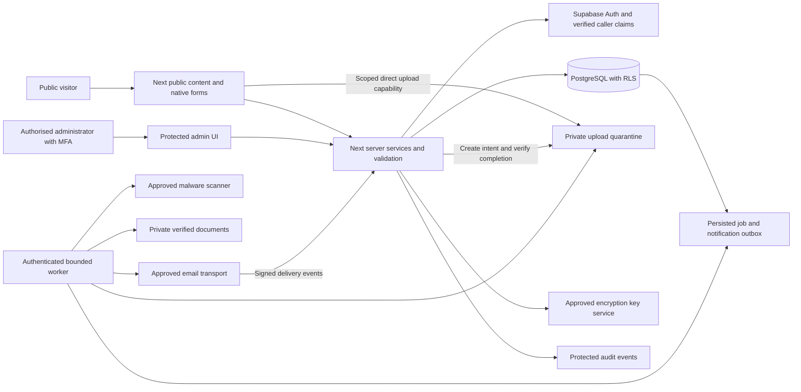

# Proposed target architecture

Status: design only. Nothing described here has been provisioned, implemented or tested. Approval of the Supabase migration and remaining business decisions is required.

## Architecture decisions

| Decision | Recommendation and reason | Alternative / condition |
|---|---|---|
| Application boundary | One Next.js App Router application with public, form, auth and protected admin route groups; TypeScript domain modules | Separate admin deployment only if stronger operational isolation is required; separate URL alone provides no authorisation |
| Rendering | Server-render public content; small client components for forms, calendar and interactive admin controls | Client-only SPA adds avoidable SEO/loading work; full static export cannot host the proposed backend |
| Backend | Next Route Handlers/Server Actions call shared services, validation, permission checks and repositories | A separate API service is unnecessary initially; extract scanning/large migration workloads into workers |
| Database | Supabase PostgreSQL with normalised business records, immutable versions and legacy-source mapping | Keeping WordPress as a headless backend is a transition option if exports or parity are unavailable; it is not the requested final Supabase architecture |
| Data access | Supabase client, generated database types and reviewed SQL/RPC transactions; caller JWT/RLS for normal admin work | Do not add Prisma/Drizzle plus a second migration system without a demonstrated need |
| Authentication | Supabase Auth for approved staff, MFA and server-side permissions; optional requester access by approved scope | Public signup/customer portal is not assumed; external accounts.rcorpo.com auth remains separate |
| Forms | Versioned declarative form definitions, safe rule/calculation engine, server-authoritative validation | Do not embed the WordPress admin or execute exported PHP/JS formulas |
| Files | Supabase Storage, separate public media and private quarantine/documents/exports | Vercel filesystem is not durable customer-document storage |
| Background work | Database outbox + bounded scheduled worker for mail/scans/exports/retention, with leases and idempotency | Add a managed durable queue/workflow only when retry/volume requirements justify it and owner approves provider/cost |
| Deployment | GitHub protected review workflow; Vercel previews and staged production release; separate Supabase environments | No preview branch should connect to production business data |

The Vercel planning guidance informed the choice of request/response Functions for the application and separate durable processing for uploads/mail. Its provisioning workflow was not executed because the owner explicitly authorised planning only.

## System relationships

## Public website

Preserve existing canonical paths, parent-child paths, contact anchors, branch details, important form labels and external links. Public modules: home, services/taxation/conveyancing links, IT subpages, team, blog, form pages, appointments, request form, newsletter and support entry. Page content is stored as approved structured blocks with draft/publish/revision handling. Page-builder shortcodes become components/content, never publicly displayed raw text.

Use a catch-all content resolver only after explicit application/form/admin routes. Reserve `/admin`, `/api`, `/auth`, `/forms-embed` and platform assets from CMS routing. Forms at existing paths resolve stable form IDs through a binding table. URL slugs are presentation identifiers, not business keys.

Public caches may contain published content and a safe form schema projection. Sessions, CSRF tokens, answers, customer data, admin pages and previews must be private/no-store. Invalidate public content caches only after a successful publish transaction. No third-party session replay on form/admin routes.

## Form lifecycle

1. Administrator creates or clones a draft definition. Stable field keys identify business answers; labels/order may change without changing those keys.
2. Builder validates field types, choices, required rules, dependencies, repeat bounds and formula AST. Reject cycles, missing references, arbitrary code and unsupported integrations.
3. Publish atomically freezes a version/hash, generates its field projection, records approval and updates page bindings/current-version pointer. Published versions cannot be edited in place.
4. Visitor receives the published public schema and a separately issued session bound to that version. In-flight submissions use the session's authorised version for a defined grace period, suggested two hours, unless administratively revoked.
5. Browser sends only bounded answer JSON and completed upload IDs. Server loads the authoritative version, removes hidden-branch answers, validates rules and recalculates totals.
6. One transaction creates the encrypted submission, links owned file intents, stores consent/version evidence, claims the idempotency key, writes audit metadata and queues notifications.
7. Receipt means durable submission received. Mail failure never deletes that submission. Files may still be scanning; notifications and admin UI show that state accurately.

Do not store tax/identity drafts in localStorage by default. Save-and-resume is a separate feature requiring signed/verified access and retention approval. Preserve existing signature wording and version history; legal sufficiency is a business/legal decision, not inferred from a canvas image.

## Admin and customer data

The admin module supports forms/fields, submissions, customers, appointments, tickets, content, media, reporting, users, permissions, audit and settings. Every read or mutation calls `requireIdentity`, `requirePermission` and a scoped repository/service; names are proposed responsibilities, not existing functions.

Customer records are distinct from login accounts. Natural people, companies and trusts can relate through reviewed associations. Historical form applicants are not automatically turned into authenticated users. Duplicate customer candidates are presented to administrators; shared emails do not silently merge records. Support agents/booking administrators receive only their authorised module/branch access, never automatic tax-submission access.

## Appointments and support

True bookings use authoritative service durations, availability, buffers, time zones and database-enforced conflict prevention. Store holds and confirmed appointments in one reservation model so both participate in the same overlap constraint. Expired holds are released transactionally before a new claim. Preferred-time submissions are separate requests awaiting human confirmation.

Support preserves ticket status, category, priority, requester, assignment, attachments, customer replies and internal notes. A generic contact fallback is not parity. Launch the new support module only when permission and source-message mapping pass acceptance, or keep a clearly identified legacy support route operational. Requester portal/sign-in scope requires owner confirmation.

## Notifications and operations

Mail templates are versioned; routing belongs to server configuration. Outbox jobs have unique event keys, attempt counters, retry times, lease ownership and terminal/dead-letter state. Workers can run more than once; handlers must be idempotent. Exactly-once inbox delivery cannot be guaranteed; use provider idempotency and deduplicated events where supported. Capture is forced outside production; old captured messages are not released automatically.

For large exports, scans and migration batches, enqueue work and return a job reference. Do not rely on a browser request remaining open or an unawaited function callback surviving. Database transactions cannot atomically commit object storage; use intent/finalisation states, reconciliation and compensating cleanup.

Use Next's supported Node runtime and align application/database regions after latency and residency review. Direct uploads avoid the [4.5 MB Vercel Function payload cap](https://vercel.com/docs/functions/limitations). The current [Supabase Storage upload contract](https://supabase.com/docs/reference/javascript/storage-from-createsigneduploadurl) is a bearer capability with provider-defined validity; application logic must not pretend it is instantly revocable.

## Business invariants

- Every accepted submission has exactly one immutable form version and a unique session-scoped idempotency key.
- Receipt response occurs only after persistence; retries return the same reference for the same request, while conflicting payload reuse is rejected.
- Applicant input never chooses an arbitrary notification destination, storage bucket, SQL filter or privileged role.
- Unpublished/internal fields and recipient configuration never appear in the public form schema.
- An infected/unscanned file is never available as a clean document.
- Every migrated source entity has one recorded disposition and a stable source mapping; import retries do not duplicate it.
- Reverting a frontend deployment does not revert new business records. Database changes remain compatible across the rollback window.

## Deferred decisions

Encryption-key service, scanning/email providers, marketing provider, requester portal, payment scope, source support version, real-data staging, region/budget and retention need owner decisions. None is filled with a fake production integration. See [PROJECT_RISKS_AND_OPEN_QUESTIONS.md](PROJECT_RISKS_AND_OPEN_QUESTIONS.md).
